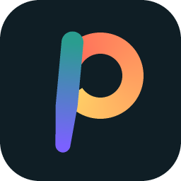

<p align="center">
  
</p>

<h1 align="center">PIRA</h1>
<p align="center"><b>Painting, Illustration &amp; Raster Art</b><br>
Create · Explore · Share · Belong</p>

---

PIRA is a free, offline-first painting app for pen tablets. Pencils, inks and paints respond to
pen **pressure and tilt from the first stroke**, with nothing to switch on. No account, no
subscription, no network needed to draw, save or export.

> [!NOTE]
> Working name, local repository, early prototype. PIRA is an independent project. It contains
> software derived from [PhotoCraft](https://github.com/storytold/photocraft) by ArtCraft
> contributors (MIT OR Apache-2.0), through the PhotoCraft Android port. It is not made or
> supported by the PhotoCraft developers or ArtCraft, and it is not affiliated with Clip Studio
> Paint. See [UPSTREAM.md](UPSTREAM.md).

## What's different from the port

| | |
|---|---|
| 🎨 **PIRA look** | A new default theme, **PIRA** (teal-navy, cream, teal and coral) and **PIRA Light** (paper cream). Picked in Preferences › Interface. |
| ✏️ **Pen-ready brushes** | A new **PIRA Essentials** group: HB, 2B and 6B pencils, mechanical and coloured pencil, fine liner, inking pen, brush pen, marker, airbrush and dry gouache. A fresh install starts on the 2B pencil. |
| 📐 **Tilt shading** | Lean the pen and the tip turns into the side of a lead: longer, flatter and lighter along the lean, on top of pressure. Upright writing stays crisp. Tune it under Brush Settings › Brush Tip Shape › Pen Tilt Shading. |
| 🖌️ **Pressure everywhere** | Every Dry and Wet Media preset now follows pressure (several ignored it), and Dry Media shades with tilt. |
| 🗂️ **Painting layout** | Opens with Color, Brushes and Layers docked. |
| 📦 **Own identity** | Android app id `art.pira` (installs beside PhotoCraft), label PIRA, placeholder icon, no auto-update from PhotoCraft's releases. |

Plan and brand material: [docs/pira/](docs/pira/) (master plan, brand palette, concept art).
A landing-page draft is in [web/landing/](web/landing/index.html).

## Build (Android, arm64)

From Git Bash with the Android toolchain described in
[apps/photocraft-android/README.md](apps/photocraft-android/README.md):

```bash
APP_VERSION=0.1.0 apps/photocraft-android/build.sh
```

The APK lands in `$CARGO_TARGET_DIR/android/pira-<version>-arm64-v8a.apk`.

## License

Code: MIT OR Apache-2.0 (`LICENSE-MIT`, `LICENSE-APACHE`), as upstream. Upstream notices are
kept in [NOTICE](NOTICE) and [ATTRIBUTION.md](ATTRIBUTION.md). The ArtCraft name and logos in
`docs/brand/` are not open source and are not part of PIRA's brand.
