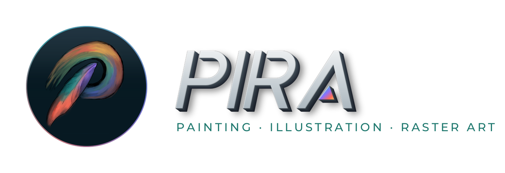

<p align="center">
  <picture>
    <source media="(prefers-color-scheme: dark)" srcset="assets/brand/pira-lockup-chrome-dark.png">
    
  </picture>
</p>

---

PIRA is a free painting app for pen tablets that works offline. Pencils, inks and paints respond
to pen **pressure and tilt** as soon as it's installed; there are no settings to turn on first.
You don't need an account, a subscription or an internet connection to draw, save or export.

> [!NOTE]
> Working name, early prototype, [PIRA-Painting-Illustration/PIRA](https://github.com/PIRA-Painting-Illustration/PIRA) on GitHub (private). PIRA is an independent project. It contains
> software derived from [PhotoCraft](https://github.com/storytold/photocraft) by ArtCraft
> contributors (MIT OR Apache-2.0), through the PhotoCraft Android port. It is not made or
> supported by the PhotoCraft developers or ArtCraft, and it is not affiliated with Clip Studio
> Paint. See [UPSTREAM.md](UPSTREAM.md).

## What's different from the port

| | |
|---|---|
| **PIRA look** | A new default theme, **PIRA** (teal-navy, cream, teal and coral) and **PIRA Light** (paper cream). Picked in Preferences › Interface. |
| **Pen, Pencil and Brush** | Three drawing tools at the top of the tool columns, each with its own brushes and remembering the last one you used. Tap the tool in use again for its brushes and their size, opacity and stabilization; each brush keeps its own size and opacity. **Pens** for line art (G-pen, inking and mapping pens, fine liner, brush pen, marker): solid ink, width from pressure, steady lines. **Pencils** for sketching (HB, 2B, 6B, mechanical, coloured, vine charcoal, soft pastel): paper grain, pressure darkens, tilt shades. **Brushes** for painting (watercolour, oil paint, blender and a round mixing brush that pick up the colour on the canvas, plus dry gouache and airbrush). A fresh install starts on the 2B pencil. |
| **Studio layout** | The menus and a command bar across the top, the tools in two columns with size and opacity sliders beside them, a full-height Layers panel with the other panels as icons, and Esc, Ctrl, Shift, Alt and Space keys on the screen edge, in neutral greys that leave the colour to the artwork. Tap the colour chips for a colour wheel with recent colours and swatches. |
| **Tilt shading** | Lean the pen and the tip turns into the side of a lead: longer, flatter and lighter along the lean, on top of pressure. Upright writing stays crisp. Tune it under Brush Settings › Brush Tip Shape › Pen Tilt Shading. |
| **Pressure on every preset** | Every Dry and Wet Media preset now follows pressure (several ignored it), and Dry Media shades with tilt. |
| **Painting layout** | Tools on both sides of the canvas: Brushes over Color and Swatches on the left, Properties over Layers on the right. |
| **Own identity** | Android app id `art.pira` (installs beside PhotoCraft), label PIRA, its own logo, no auto-update from PhotoCraft's releases. |

Plan and brand material: [docs/pira/](docs/pira/) (master plan, brand palette, concept art).
A landing-page draft is in [web/landing/](web/landing/index.html).

## Build (Android, arm64)

From Git Bash with the Android toolchain described in
[apps/photocraft-android/README.md](apps/photocraft-android/README.md):

```bash
APP_VERSION=0.1.0 apps/photocraft-android/build.sh
```

The APK lands in `$CARGO_TARGET_DIR/android/pira-<version>-arm64-v8a.apk`.

## License

Code: MIT OR Apache-2.0 (`LICENSE-MIT`, `LICENSE-APACHE`), as upstream. Upstream notices are
kept in [NOTICE](NOTICE) and [ATTRIBUTION.md](ATTRIBUTION.md). The ArtCraft name and logos in
`docs/brand/` are not open source and are not part of PIRA's brand.
