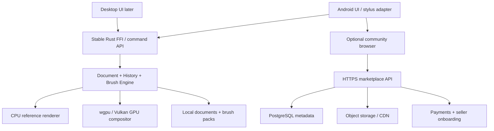

# PIRA — Open-Source Painting Platform

**Integrated business plan, product requirements, engineering strategy, and community marketplace blueprint**  
**Status:** Proposal / discovery baseline; not an implemented product  
**Version:** 0.1 • **Date:** October 29, 2026  
**Working name:** PIRA — Painting, Illustration & Raster Art (provisional; perform trademark and name clearance before publication). Earlier drafts used "PIRA".  
**Project origin:** Independently branded application inspired by and potentially derived from ArtCraft PhotoCraft (`storytold/photocraft`).

> **Decision in one sentence:** Build a free, offline-first, tablet-native professional painting app on a reusable Rust document/rendering core, and operate an optional, separately hosted brush-and-assets community with free and paid offerings. **The marketplace must never be required to paint.**

## 1. Executive summary

### Vision
Make capable, pressure-and-tilt-sensitive digital drawing and painting accessible without recurring license fees or vendor lock-in, while giving individual creators a sustainable way to share or sell their craft.

### Problem
Artists face subscriptions, fragmented brush formats, platform-specific features, varying stylus quality, and dependence on vendor accounts for tools. Existing free applications prove demand for open creative software, but high-quality Android tablet painting remains a demanding engineering niche. The project must compete on actual brush feel, responsiveness and workflow—not mere feature count.

### Solution
1. **Free professional studio:** layers, selections, transformations, drawing assistants, customizable brushes, undo/history, autosave, and export; no required sign-in, network connection, ads or paid tool unlocks.
2. **Brush-first experience:** pencil, ink, marker, dry media, watercolor-style and oil-style brush families, pressure and tilt interpreted consistently, color blending, adjustable stabilization, expressive stroke rendering and a tablet-oriented workspace.
3. **Open ecosystem:** a public brush-pack specification, local import/export, GitHub-hosted source, community documentation, and in-app discovery of voluntarily published free/paid packs.
4. **Optional commerce:** creators retain ownership and set prices or offer free downloads; payment infrastructure is not part of the core application runtime.

### Strategic positioning
**“Professional painting without a subscription, with an open community of artists and brush makers.”** Competitors/workflow references include Clip Studio Paint, Procreate, Krita, and Infinite Painter. Do not claim feature or performance parity without comparative testing.

### First platform
Android ARM64 drawing tablets, with the Wacom MovinkPad 11 as initial reference hardware; consider desktop Linux/Windows/macOS once architecture and contributor capacity support it. A cross-platform Rust core is an objective, not a guarantee that UI or hardware work is automatically portable.

### Success definition
An artist can install the app, disconnect from the internet, sketch with pressure and tilt, paint on multiple layers, save/reopen without loss, and export an image. A second artist can separately publish a non-executable brush pack that the first can install without sacrificing local document privacy.

## 2. Source-code strategy and intellectual property

**Verified upstream facts:** PhotoCraft is a Rust workspace with reusable crates, CPU/GPU compositors, sparse copy-on-write tiles, brush dynamics, and a command-driven architecture. The upstream source is dual-licensed **MIT OR Apache-2.0**. Its ArtCraft name, wordmarks and logos are expressly outside that source license. Existing Android ports are independently maintained and should be audited before reuse.

**Project policy:**
- Start a new independently branded repository and product identity. Preserve license files and required notices for any imported upstream code; document fork point/commit and changes in `UPSTREAM.md`.
- Review *every* imported third-party font, icon, shader, sample image and brush asset separately. Do not assume code licensing covers assets or names.
- Use `Apache-2.0 OR MIT` for original program code unless a dependency/licensing review justifies a different choice. This document is a recommendation; official repository license is adopted at initialization.
- Keep program source licenses distinct from creator-uploaded assets: the latter can use CC0, CC BY 4.0, or a clearly defined **commercial brush-content license**. Paid brush files need not be open-licensed just because the installer/editor is open source.
- Supply a factual upstream credit in About/Credits and documentation: “Contains software derived from PhotoCraft by ArtCraft contributors, licensed under MIT OR Apache-2.0,” if code is actually imported.
- The provisional product name **PIRA** requires trademark and namespace clearance; do not imply any affiliation with Clip Studio Paint or ArtCraft. Develop a distinct interface based on general interaction patterns, not copied proprietary assets or near-identical trade dress.
- Avoid direct redistribution or reverse engineering of proprietary Clip Studio Paint brush bundles, UI artwork or protected program code without authorization.

**Go/no-go audit:** inspect PhotoCraft engine crate boundaries and API stability; profile Android GPU backend; read upstream NOTICE/ATTRIBUTION; assess Android port provenance; conduct baseline memory/performance tests; choose a pinned upstream snapshot and a periodic integration process. Reusing PhotoCraft should remain a reversible decision: the core must be swappable behind well-defined interfaces.

## 3. Customers and market validation

| Segment | Primary job | Why adopt | Discovery method |
|---|---|---|---|
| Hobbyist and returning artists | Sketch, study, draw on a tablet | Free, immediate, responsive | 15–20 usability interviews; sketch challenge |
| Serious illustrators / comic artists | Layers, ink, rulers, perspective | Reliable professional workflow | 10 workflow interviews; timed comic page test |
| Traditional-media artists | Pencil grain, oils, watercolor-like painting | Natural brush behavior | Blind A/B paint samples |
| Brush creators | Distribute free/premium resources | Transparent payout and ownership | 10 creator interviews; manual catalogue pilot |
| Open-source developers | Contribute graphics, Android and Rust code | Modular scope; clean documentation | Contributor onboarding pilot |

**Market research policy:** no unsourced TAM/SAM/SOM claim. Validate demand with observable metrics: interview conversion; waitlist signups; testers completing drawings; 7-day returning usage; brush-creator uploads; % of users who remain offline and productive. Benchmark against free alternatives as well as paid competitors.

**Hypotheses to test first:** (H1) expressive pencil and inking quality is a stronger adoption driver than filter breadth; (H2) a first-class Android UI wins more users than ported desktop menus; (H3) free community packs drive trust and acquisition before paid packs generate meaningful income; (H4) users will value optional, genuinely portable brush formats.

## 4. Business model and legal entity strategy

### Core commitment
No subscriptions for the editor, no feature-locked “pro mode,” no required login to use brushes or documents, and no ads embedded in painting workflows. Offline use must not trigger a license check.

### Revenue streams (prioritized)
1. **Optional marketplace commission:** proposed 15% of paid brush/asset sales; free uploads/downloads incur no platform fee. Processing, refunds, chargebacks and taxes must be shown transparently before sale; the proposed rate is a hypothesis, not a settled price.
2. **Voluntary donations / GitHub Sponsors:** fund maintenance and device testing; sponsorship must not confer exclusive drawing functionality.
3. **Optional one-time support purchases:** e.g., donor bundles or merch, provided they do not become concealed feature gates.
4. **Future institutional services:** paid custom deployment, integration, training and support (never required for normal drawing).

### Example marketplace unit economics — illustrative only
Assumptions: $8 average paid pack; platform commission 15%; card processing *modeled*, not quoted, at 2.9% of transaction value plus $0.30 per sale; platform absorbs processing cost; no tax, payout, foreign-exchange, chargeback or refund costs included.

| Paid sales / month | GMV | Gross 15% fee | Example processing cost | Remainder before operations |
|---:|---:|---:|---:|---:|
| 200 | $1,600 | $240 | $106 | $134 |
| 2,000 | $16,000 | $2,400 | $1,064 | $1,336 |
| 10,000 | $80,000 | $12,000 | $5,320 | $6,680 |

The project must **not** treat GMV as its revenue, and even 2,000 paid pack transactions per month would fund little staffing after infrastructure, moderation, tax and dispute costs. This supports a staged model: run a free catalogue first; launch commerce only when volume and governance justify it. Review actual Stripe Connect fees/pricing and merchant-of-record responsibilities before enabling sales.

### Operational budget (planning envelopes, not quotes)
- **Volunteer prototype:** $0–$250/month recurring hosting/services, plus device purchases, test hardware and founder time. A static landing site, GitHub Releases and manual free-pack indexing can be close to zero cash outlay.
- **Early community + hosted catalogue:** $100–$800/month for storage/CDN, monitoring, moderation/support and transactional email, depending on traffic and chosen providers.
- **Paid marketplace:** additional payment fees, legal review, compliance, tax/accounting, payout/customer-support labor, chargeback reserves and security. Model a $2,000–$10,000 prelaunch professional-services/compliance contingency, not a guarantee of sufficiency.
- **Professional engineering labor:** if hiring, budget separately using actual contractor bids; volunteers do not erase maintenance and ownership obligations.

**Legal entity decision:** Launch an open-source organization first. Before handling sales/payouts, form an appropriate legal entity, establish business bank/accounting/tax processes, determine marketplace merchant-of-record model and seller eligibility, and obtain legal/accounting review. Consider a fiscal host only if appropriate for donations; it does not automatically solve marketplace liabilities.

## 5. Product requirements document (PRD)

### Personas and core stories
- **Artist:** As an artist I can open the app in airplane mode, use a pencil with pressure and tilt, work with layers, save and export without an account.
- **Illustrator:** As a comic artist I can work with perspective rulers, stabilization, selections, clipping masks and a dependable undo stack.
- **Brush maker:** As a creator I can build, preview, export and share a portable brush pack with credits and license information.
- **Buyer:** As a customer I can see preview strokes, sample artwork, compatibility, price, terms and author before choosing to install a pack.
- **Moderator:** As a moderator I can quarantine unsafe files, respond to reports, remove listings and communicate appeals without having access to private canvases.

### Functional requirements / prioritized release scope

| ID | Priority | Requirement | Acceptance condition |
|---|---|---|---|
| P-01 | P0 | Create/open/save native document | Save/reopen with layers, brush strokes and color preserved; corrupt write never overwrites last good file |
| P-02 | P0 | Continuous stylus drawing | Pressure affects size/opacity; tilt-capable brushes use tilt by default; no need to enable tilt for each preset |
| P-03 | P0 | Smooth canvas gestures | Two-finger pan/zoom/rotate, palm-rejection strategy and pen/finger distinctions |
| P-04 | P0 | Brush families | Usable graphite pencil, ink pen, soft paint, textured marker and eraser with editable dynamics |
| P-05 | P0 | Layer operations | Create/reorder/rename/hide/opacity/merge groups; at least standard blend modes and clipping |
| P-06 | P0 | Offline persistence | Project save, autosave, export to PNG/JPEG and local brush import all work in airplane mode |
| P-07 | P0 | Edit history | Undo/redo predictable under long strokes; restore from forced termination |
| P-08 | P0 | Performance instrumentation | Captures time-to-ink, frame pacing, memory consumption and crash reports locally/opt-in |
| P-09 | P1 | Brush Studio | Design presets, per-sensor curves, tip and grain settings; export packs |
| P-10 | P1 | Painting workflows | Selection/lasso, transform, symmetry and perspective ruler; color wheel and palette |
| P-11 | P1 | Interoperability | OpenRaster import/export, PSD import (when validated), flattened formats; warn on feature loss |
| P-12 | P1 | Community panel | Browse/download free curated content; optional account only for posting/reporting |
| P-13 | P2 | Paid creator marketplace | Seller onboarding, checkout, purchase library, refunds, reporting and payouts; separate release gate |
| P-14 | P2 | Advanced paint simulation | Pigment diffusion, wet-on-wet, bristle loading, impasto-like effect where feasible |
| P-15 | P2 | Desktop distribution | Reuse core; separate native desktop shell and stylus testing |

**Explicitly out of scope for MVP:** cloud project storage, collaborative real-time painting, AI image generation, animation timeline, full Clip Studio Paint parity, social DMs, and automatic import of arbitrary proprietary brush formats.

### Nonfunctional targets (engineering targets, not promised specifications)
- Reference device: Wacom MovinkPad 11 with Pro Pen 3; verify the actual Android events exposed by the device before committing to tilt or eraser behavior.
- Perceptual responsiveness: aim for **p95 stroke-to-visible-ink under 35 ms** on target hardware, measured with a high-speed-camera/input-to-display method and instrumented estimates; record methodology.
- Canvas: target stable **60 FPS** for normal drawing at approximately 2K canvas resolution with 20 ordinary layers; publish precise benchmark scenes and exceptions.
- Reliability: target **at least 99.5% crash-free sessions** in opt-in beta telemetry; autosave with atomic replacement and previous good copy.
- Memory: impose configurable tile/cache budgets; warn about canvas size before allocation; reduce cache under Android memory pressure.
- Accessibility: scalable controls, left/right handed layout, keyboard shortcuts, touch targets, screen reader support for noncanvas UI.
- Privacy: core creates no account, sends no document content to servers, and has no mandatory telemetry.

### Painting-quality acceptance tests
1. Pressure ramp: 10 short strokes with constant and rising pressure, deterministic observable change in opacity/width.
2. Tilt shading: pencil creates finer line upright and wider grain on a low-angle stroke without toggling a switch.
3. Velocity: stroke interpolation and stabilizer avoid discontinuities for slow spirals and quick flicks.
4. Wet look: blend preset shows coherent pickup/deposition, no repeated halos or unnatural saturation; initial approximation is clearly labeled as such.
5. Recovery: forced termination during repeated strokes reopens the most recent safe checkpoint.
6. Interchange: open and export baseline OpenRaster sample with known layer ordering and blend output.
7. Stylus interaction: tapping toolbar with a finger while holding pen causes no accidental ink; rotated device maps orientation consistently.

## 6. Interaction design and UX system

### Three spaces, not one overloaded screen
- **Canvas (default):** full-screen drawing, compact tool rail, floating color wheel, layers panel, configurable radial shortcuts and accessible undo/redo.
- **Brush Studio:** tip shape/grain, size, spacing, scatter, wetness, pressure/tilt/rotation curves, preview stroke, save/version/export; show live sensor telemetry for diagnosing devices.
- **Community:** a collapsible optional panel with Discover, Free, Paid, My Library, Publish, Report, and Settings. Canvas features remain available without community login.

**Principles:** fast first stroke, no modal interruption during drawing, left/right handed layouts, tool state visible at a glance, no dark patterns, no notifications unless explicitly enabled. Use original icons/color palette; do not reproduce Clip Studio Paint's protected branded visual design.

### Brush priority
**Tier 1:** HB/2B/6B graphite, mechanical pencil, fine liner, ink, marker, airbrush, dry gouache.  
**Tier 2:** colored pencil, charcoal, watercolor wash, smudge and realistic oil.  
**Tier 3:** natural-bristle physics, fluid mixing, canvas height/impasto, dynamic materials.  
The oil workflow should be prototype-tested separately: credible wet mixing and bristle behavior may require a purpose-built pigment simulation engine rather than simply attaching new textures to PhotoCraft brushes.

## 7. Technical architecture



**Recommended stack:**
- **Core:** Rust workspace; adapt permissively licensed PhotoCraft document/compositor/commands when the dependency audit passes. New drawing algorithms remain independent modules and can be submitted upstream if broadly useful.
- **Android:** Kotlin + Jetpack Compose for native navigation/community/settings; low-overhead `SurfaceView`/Vulkan canvas with JNI/UniFFI/cbindgen-managed Rust interface after benchmark. Alternative all-Rust `egui` UI remains a spike, but desktop-scale controls are not the intended Android experience.
- **Drawing input:** Android `MotionEvent` tool type, pressure, `AXIS_TILT`, `AXIS_ORIENTATION`, history, hover, stylus buttons and eraser where available; normalize into an internal `PenSample {x,y,time,pressure,tilt,azimuth,buttons,tool_type}`. Do not confuse stylus tilt with barrel rotation, which may be unavailable. If sensor values are absent, use graceful brush defaults and disclose limitation.
- **Rendering:** keep reference CPU compositor for reproducibility and tests; evaluate tiled GPU strokes, low-latency partial updates and per-tile dirty regions. Ensure canvas color-management path and blend behavior are tested.
- **Storage:** private app files plus Android Storage Access Framework, atomic document writes, journal/recovery snapshots. Avoid broad All Files Access permissions without strong justified need.
- **Remote services:** public browse/download API; optional account via OAuth/passkey; signed upload URLs, metadata service, moderation queue, payment webhook processor. Proposed: Postgres + object storage + CDN, bounded-cost hosting.
- **Observability:** opt-in anonymized crash reports and local benchmark panel. No user artwork uploaded by default.

### Repository topology
```text
pira/
  apps/android/                 # Kotlin app, Gradle, JNI and Android rendering shell
  apps/desktop/                 # later; separate desktop UI
  crates/paint-core/            # strokes, brush/pigment algorithms
  crates/document/              # adapted core or upstream wrapper
  crates/graphics/              # GPU integration and CPU oracle
  crates/brush-format/          # declarative brush-pack parser
  crates/platform-api/          # FFI and command interface
  services/community-api/       # separately deployed; no hard runtime dependency
  web/marketplace/              # optional browser storefront
  docs/                        # ADRs, PRD, compatibility matrix, benchmarks
  tests/fixtures/              # reproducible strokes and format round trips
```

**Dependency rule:** the editor may talk outward to the community module; the core engine must never import marketplace/network/payment crates. A network failure must never block opening the canvas, brush selection, save or export.

### Native document format
Adopt a documented, ZIP-like versioned `.pira` bundle (placeholder extension until name is cleared) with manifest, layer metadata, tile images, color profiles, optional stroke descriptors, and a deterministic recovery journal. File paths must be validated; upgrades must be versioned; never silently destroy unsupported feature data. Implement OpenRaster for portable layered transfer. Treat PSD as best-effort with fidelity tests and export warnings, not guaranteed lossless parity.

## 8. Brush-pack standard and extensibility

**Open packaging:** `.pirabrush` (provisional) is a bounded ZIP containing `manifest.json`, brush definitions, PNG/WebP texture tips, previews and license/attribution files. No JavaScript, native code, executable plug-ins or arbitrary URLs in a pack. Keep a JSON Schema and test vectors in the public repository.

Sample manifest (conceptual, schema subject to change):
```json
{
  "schema_version": "1.0.0",
  "pack_id": "org.example.graphite-starter",
  "pack_version": "1.0.0",
  "name": "Graphite Starter",
  "creator": "Example Creator",
  "license": "CC-BY-4.0",
  "minimum_app_version": "0.2.0",
  "brushes": [
    {
      "id": "soft-2b",
      "display_name": "Soft 2B Pencil",
      "definition": "brushes/soft-2b.json",
      "preview": "previews/soft-2b.png"
    }
  ],
  "resources": ["textures/paper-grain.png"]
}
```

**Mandatory install checks:** path traversal/symlink rejection; size, decompression ratio and file-count limits; image dimension caps; schema/type validation; collision-safe namespaces; SHA-256 integrity; content screening for public uploads; opaque store receipt kept separate from the pack file. Content is data, never executed. Downloaded purchased content must remain usable without an online license handshake; users can re-download through their optional account subject to store terms.

**Asset licenses:** free creators choose from approved licenses with attribution displayed; paid creators use a plain-language personal/commercial usage license, with restrictions on reselling standalone assets, but not on selling finished artwork. Never pretend the marketplace owns rights to user uploads. Provide a dispute and takedown/appeal process.

## 9. Community and marketplace business specification

### Release stages
- **Stage A — free library:** hand-curated brush packs, browse/search/tags, compatible app version, reviews limited to reports/feedback, direct download and local install. No payments.
- **Stage B — creator accounts:** verified contact methods, upload wizard, preview requirement, license selection, public author page, attribution, report/block tools and moderation.
- **Stage C — commerce:** approved sellers, identity/tax onboarding, processor integration, checkout, buyer entitlements/re-download, refunds, disputes, payouts, reconciliation, and support operations. Launch only after policy and security reviews.

### Required buyer journey
Discover > inspect high-resolution stroke previews and compatibility > see free/price and license > authenticate only if needed for paid purchase > checkout (store compliant) > verify payment server-side > download hash-verified pack > install offline > library records source/version/license. Users should also be able to import `.pirabrush` files obtained outside the marketplace.

### Seller journey
Create account > accept creator terms > optional seller eligibility and payment onboarding > upload pack > automated scan > human review of first submissions/flagged cases > price/license > preview listing > publish > view sales, refunds, payout balances and reports > request takedown or appeal.

### Payment architecture and policy
**Stripe Connect** is a candidate for **web-hosted** creator onboarding and payouts, but it explicitly distinguishes marketplace merchant-of-record responsibilities, fees, disputes and tax liabilities. Do not describe Stripe as automatically assuming those responsibilities. For an Android app distributed on Google Play, paid digital brush content inside the app may require Play Billing unless a specific permitted exception applies; design the payment path only after evaluating current policies by distribution channel and region. A checkout on a web site is not automatically an allowed in-app workaround. Legal/policy review is a release blocker.

### Community safety and moderation
- Terms of use and community rules accepted before upload; user ownership and licensing declaration.
- Report content, report users, block users, moderation queue, appeals, documented response windows.
- No public messaging/DMs during early phases; lower harassment/support burden.
- Prohibit malware, executable payloads, deceptive listings, copyright infringement, threats/harassment and prohibited sexual/illegal content.
- Content provenance fields; human moderation for initial seller uploads; abuse-rate limits, seller verification and repeat-offender controls.
- Secure storage, malware/media scanning, limited preview metadata, privacy notice and data-retention/deletion process.
- If hosted in jurisdictions requiring additional platform disclosures or consumer rights, obtain appropriate counsel and compliance checks (including EU/US rules as applicable).

### Minimal backend data model
`users(id,handle,status)`; `creators(user_id,display_name,verification_status)`; `packs(id,slug,owner_id,version,license,visibility,moderation_state)`; `assets(pack_id,sha256,size,mime,storage_key)`; `listings(pack_id,price,currency,status)`; `orders(id,buyer_id,total,tax,status,processor_id)`; `entitlements(order_id,pack_id,buyer_id)`; `payouts(creator_id,amount,status)`; `reports(id,reporter_id,target_id,reason,state)`; `moderation_actions`; `audit_log`. Personal/payment data should be minimized, and processor account data should not be cloned unnecessarily.

## 10. Delivery roadmap and stage gates

| Phase | Duration* | Deliverables | Release gate |
|---|---|---|---|
| 0 — diligence | Weeks 1–3 | Name/legal scan, license audit, hardware trace, upstream profiling, 20+ artist interviews, MVP design | Proven Android render path; baseline test project; no license conflicts |
| 1 — engine vertical slice | Weeks 4–10 | Native canvas, pen pipeline, 5 brush presets, layer stack, save/recovery, rendering telemetry | Draw, save, reopen offline; tilt/pressure tests on target hardware |
| 2 — private alpha | Weeks 11–20 | Brush Studio, gestures, palettes, selectors, more brushes, crash fixes, export | 20 alpha artists finish real work; tracked performance and reliability |
| 3 — public beta | Weeks 21–32 | App documentation, 30 curated free packs, community browse, code-of-conduct, issue triage | Privacy/security review; 100 testers; repeat drawing session rate |
| 4 — 1.0 free release | Weeks 33–52 | Supported Android ARM64 release, release signing, format guarantees, tutorials, community governance | Published QA matrix; compatibility claims measured; sustained maintainers |
| 5 — marketplace | After 1.0 and legal readiness | Seller onboarding, compliant checkout, refunds, payouts, moderated paid packs | Payment policy, tax, operational and abuse processes rehearsed |

*Durations are aggressive estimates for a coordinated team with existing reusable engine code, not promises for a solo developer. A solo hobby project may require 12–24+ months, especially for a credible oil-paint engine.

### First 30 days / concrete backlog
1. Establish independent name and GitHub organization; decide permissive license; create `NOTICE`, `ATTRIBUTION`, `UPSTREAM` inventories.
2. Capture stylus pressure/tilt/orientation/eraser/historical samples on MovinkPad 11; produce input diagnostic screen and trace fixture.
3. Build Android Rust `wgpu` triangle/canvas smoke test and baseline frame-time/memory capture.
4. Isolate PhotoCraft brush model and compositor API at pinned commit; create a compatibility/portability matrix.
5. Make pencil testbed: one pressure-sensitive graphite brush with default tilt shading, grain and 3-way stability benchmark.
6. Build open/save/recovery for single layer, then multi-layer; test failure injection.
7. Interview artists/brush sellers; conduct competitor brush A/B test and document workflows.
8. Publish contributor documentation, code review rules, labels, community moderation minimums and transparent public roadmap.

### Proposed milestones
`M0 Discovery`; `M1 Pen-to-Canvas`; `M2 Layers and Files`; `M3 Brush Studio`; `M4 Free Library`; `M5 Release Candidate`; `M6 Marketplace`.

## 11. Team and project operating model

**Suggested initial roles:** project lead/product owner (prioritization, licensing, funding); Rust rendering lead; Android UI/input lead; digital brush artist/QA; community/moderation lead; optional backend developer once free catalogue is ready. One person may occupy multiple roles, but use a public ownership matrix and avoid single-maintainer production secrets.

**Working process:** GitHub Projects Kanban (`Discovery → Ready → In progress → Review → QA → Done`); 2-week sprint-like review cadence; architectural decision records (ADRs); semantic versioning where applicable; squash/review merge rules; mandatory CI (Rust fmt/clippy/tests, Android build smoke checks, content parser fuzzing, signed release process). Use public Discussions for product decisions, Issues for scoped tasks, and a documented release-support policy.

**Contribution policy:** no CLA at the outset unless counsel identifies a need; use Developer Certificate of Origin sign-offs or standard contributions under repo license. Credit authors; use CODEOWNERS/review on security, payment and format-schema changes. Keep upstream contribution pathway open.

**Governance maturation:** founder-led until public beta; publish decision logs, maintainer nomination path and conflict-of-interest policy; consider a small elected/appointed technical steering group only once substantive outside contributions exist.

## 12. Security, privacy and quality assurance

**Trust boundary:** untrusted community pack/upload, network content and document files enter robust parsers; neither marketplace content nor server responses may issue privileged drawing/editor commands. Never execute scripts from imported brush packs.

**Technical security:** dependency scanning/SBOM, regular audits, fuzz ZIP/brush/PSD parsers, secure credentials on Android, TLS, upload content scanning, signed releases, integrity hashes, strict CDN/object-storage permissions, replay-resistant payment webhooks, permissioned moderation actions, rate limits, and logs without artwork/personal secrets. Publish vulnerability disclosure instructions and support window.

**Testing matrix:** reference MovinkPad 11 + at least two additional Android stylus families; Android OS/API variations; large and small documents; device rotation; background/foreground; pen/finger mixed touch; low storage; airplane mode; low RAM; recovery across app death; SD card/SAF provider failures; color profile issues; importing malformed brush-pack files. Compare CPU reference renderer with GPU output under known tolerances.

**Release gate:** independent audit of permissions, license inventory, critical crash fixes, restore test, telemetry opt-in, pack parser fuzz results, basic accessibility checks, published known limitations, and rollback/update documentation.

## 13. Growth and adoption plan

**Prelaunch:** publish weekly development notes and real captured pencil/oil demos on the reference tablet. Maintain a public changelog and benchmark dashboard instead of broad promises. Recruit ~20 artist testers and ~10 volunteer brush creators from existing open-art communities with clear permission and attribution.

**Beta:** ship tutorials, a “draw this scene” reproducible brush challenge, galleries of real user artwork (opt-in), short YouTube demos and a downloadable starter bundle. Incentivize brush creators through visibility/attribution, not paid rankings.

**At 1.0:** publish a transparent compatibility table vs user workflows (not unsupported competitive claims); open GitHub Discussions, discoverable documentation site and accessible downloads. Partner with education/open-source groups, not through mandatory account integrations.

### KPI dashboard
- **Product:** completed artwork sessions, 7/30-day active artist retention, crash-free sessions, median and p95 ink latency, save failures/1000 sessions, brush preset usability score.
- **Community:** accepted pack uploads, unique active creators, free pack installs, report resolution time, moderation reversal rate, pack compatibility failures.
- **Market:** approved sellers, paid conversion from viewing, average selling price, GMV vs *net contribution margin*, refund and chargeback rates, creator payout time, dispute exposure.
- **Governance:** maintainer bus factor, first-response time, merged outside PRs, security fix turnaround, open critical regressions.

Never assume analytics consent, and do not compromise offline mode to inflate tracking completeness.

## 14. Key risks and decision register

| Risk | Likelihood / impact | Mitigation / trigger |
|---|---|---|
| Rust engine UI not portable to tablet | High / High | Native Android UI spike before committing to full port |
| Realistic oils overwhelm schedule | High / High | Separate R&D milestone; ship honest textured paint presets first |
| Brush quality not competitive | Medium / High | Blind artist A/B, measurable tilt and blending criteria |
| Upstream changes destabilize port | Medium / High | Pinned commit, update cadence, wrapper interfaces, contract tests |
| Community hosting becomes costly | Medium / Medium | Free catalogue quotas, storage limits, CDN and budget alerts |
| Illegal or infringing uploads | High / High | Moderation, ownership attestations, reporting/takedown/appeals |
| Payments cause platform-policy violation | Medium / High | Channel-specific billing review; do not ship checkout before approval |
| Seller payout/tax obligations exceed capacity | Medium / High | Defer paid marketplace; seek counsel and fiscal/merchant model |
| Sponsor pressure toward a paywall | Medium / High | Publish non-negotiable community charter and revenue transparency |
| Name/trademark collision | Unknown / High | Clearance before domain, app package and launch branding |

**Decision log to resolve:** D-001 product name; D-002 upstream fork versus crate consumption; D-003 Android Compose versus egui shell; D-004 native file extension; D-005 brush schema and commercial brush license; D-006 hosting and account provider; D-007 marketplace payment/tax model; D-008 app distribution (GitHub/F-Droid/Play).

## 15. Launch criteria and recommendation

**Launch the free app before the paid marketplace.** The defensible product is an excellent, independent painting environment. The store is a community feature that can support sustainability later, but it multiplies legal, payment, moderation, and technical obligations before the app earns trust. A staged, separate service keeps the promise of offline ownership credible.

**First irreversible decision to avoid:** committing to a trademark/package name, proprietary brush system, or checkout architecture before a working stylus prototype and licensing review.

**Near-term proof of concept:** A smooth 2B pencil on the MovinkPad 11 that automatically broadens with tilt, a 20-layer test document, robust save/recovery, and a simple brush-pack file loaded entirely offline. Demonstrate these before promising a Clip Studio Paint-class replacement.

## 16. Sources and external validation (checked 2026-10-29)

These sources establish upstream capabilities, license conditions and external platform requirements; competitive demand, budgets, schedules and benchmark targets above are **project hypotheses/estimates**, not sourced market facts.

1. ArtCraft PhotoCraft — official repository, architecture, brushes, licensing: https://github.com/storytold/photocraft
2. PhotoCraft NOTICE / source licensing: https://github.com/storytold/photocraft/blob/main/NOTICE
3. ArtCraft branded asset terms: https://github.com/storytold/photocraft/blob/main/docs/brand/LICENSE-brand.txt
4. PhotoCraft attribution inventory: https://github.com/storytold/photocraft/blob/main/ATTRIBUTION.md
5. Android `MotionEvent` tilt, pressure, orientation: https://developer.android.com/reference/android/view/MotionEvent
6. Google Play payments policy (digital goods): https://support.google.com/googleplay/android-developer/answer/9858738
7. Google Play user-generated content moderation policy: https://support.google.com/googleplay/android-developer/answer/9876937
8. Stripe Connect marketplace architecture and responsibilities: https://docs.stripe.com/connect/marketplace
9. GitHub community health documentation: https://docs.github.com/en/communities/setting-up-your-project-for-healthy-contributions
10. GitHub Sponsors documentation: https://docs.github.com/en/sponsors
11. Independent Android port example (third-party; not audited): https://remade.wiki/tools/photocraft-android/
12. Krita/MyPaint dynamic inputs reference (external behavior only, not license permission): https://docs.krita.org/en/reference_manual/brushes/brush_engines/mypaint_engine.html

---

**Important:** This blueprint is a proposed strategic specification, not a claim that a tested app, merchant account, marketplace or uploaded GitHub repository already exists. Financial and legal assumptions should be reviewed by qualified professionals before accepting payments or distributing third-party assets.
