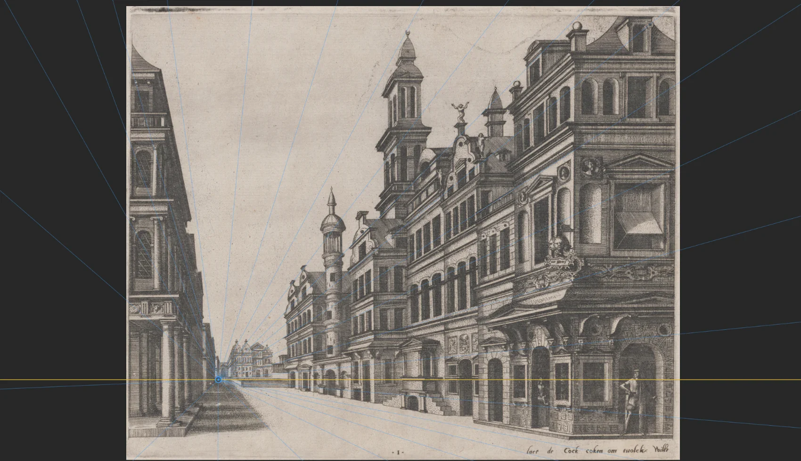
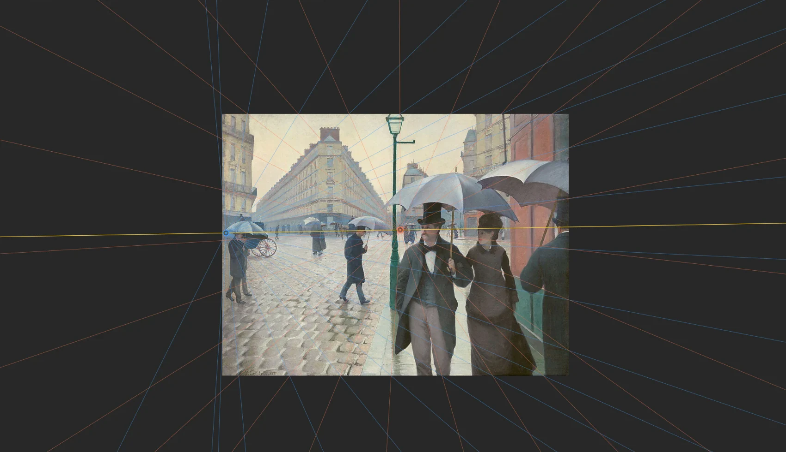
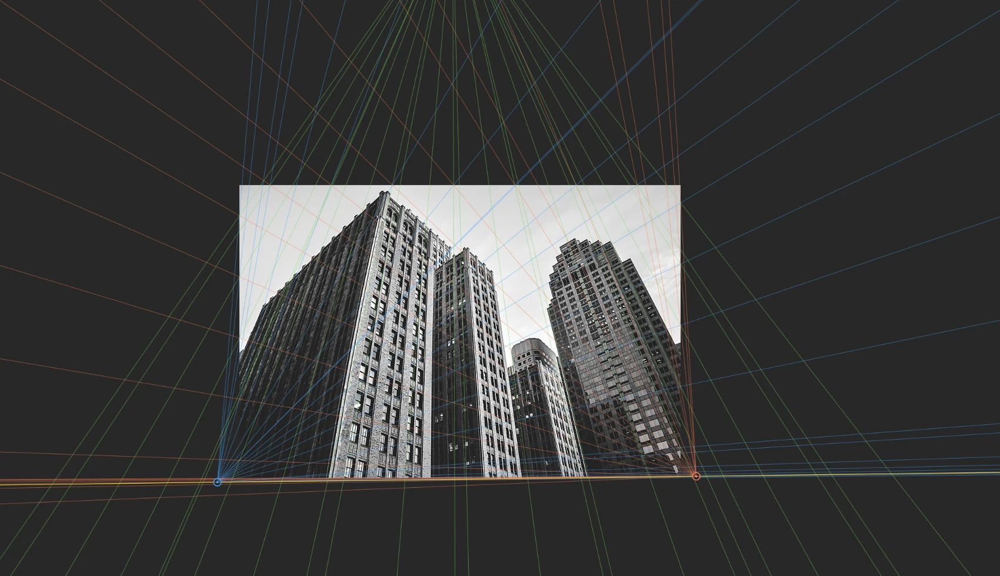

# Rulers and guides

## Special rulers

Special rulers pull your strokes onto a guide shape as you draw. Pick the **Ruler tool**, choose a
**Special Ruler Kind** in the options bar, and draw the ruler on the canvas. Its handles reshape it
afterwards.

| Kind | Strokes follow |
|---|---|
| **Straight** | One straight line |
| **Curve** | A curve you draw |
| **Concentric** | Circles or ellipses around a centre |
| **Parallel** | Lines parallel to the ruler |
| **Radial** | Lines out from a centre (focus lines, sunbursts) |
| **Fisheye** | Arcs through two vanishing points, for fisheye perspective |

- A stroke snaps to whichever guide it's heading along, so you can draw freely near it.
- Rulers belong to a layer (or to every layer) and are saved in the `.pcraft` file.
- **View › Special Rulers** turns snapping on or off, shows or hides the rulers, and clears them.

## Perspective ruler

The perspective ruler sets up one-, two- or three-point perspective. Pen, pencil and eraser
strokes snap toward a vanishing point or run upright, so freehand lines come out straight and
aimed at the right point.

- Pick the **Ruler tool** and choose **Perspective** in the options bar: **1-Point**, **2-Point**
  or **3-Point**. **Show** and **Snap** sit beside it.
- With the Ruler tool, drag the vanishing points on the canvas; the eye level follows. Painting
  tools never grab them, so a stroke can start on one.
- A stroke picks the closest direction from its first few points, then stays on that line.
- While a ruler exists, the painting tools' options bar has a snap switch next to symmetry, for
  flipping between snapping and drawing freely. Shift still draws straight lines in 45° steps.
- The ruler is saved in the `.pcraft` file, and placing or moving it can be undone.

**1-point:** one vanishing point on the eye level. Strokes go toward it, level or upright.

*Lucas and Johannes van Doetecum after Hans Vredeman de Vries, Perspective View of a Street, 1560
(National Gallery of Art, CC0).*

**2-point:** two points on the eye level. Strokes go toward either, or upright.

*Gustave Caillebotte, Paris Street; Rainy Day, 1877 (public domain).*

**3-point:** adds a third point that upright lines converge on, for looking up or down at tall
things.

*Skyscrapers from below, photo by Davide Ragusa (CC0, via Wikimedia Commons).*

## Symmetry

Paint with symmetry across a straight line or along a path; the brush tools' options bar turns it
on and sets the axis.

## Guides and grids

- **View › Rulers** (Ctrl+R) shows the rulers along the canvas edges; drag from them to make guides.
- Guides, grids and snapping are under **View**, as in Photoshop.
- [Comic pages](Comic-Pages.md) come with guides for the trim and safe area.
